# Uniciclo

O desempenho de uma máquina pode ser determinado por três fatores: 
- Número de instruções executadas 
- Período do clock (ou frequência) 
- Número de ciclos por instrução (CPI) 

Para um determinado algoritmo, o compilador e a **ISA** (***Instruction  Set Architecture***) determinam o **número de instruções a serem executadas**. 

A **implementação do processador** determina o **período de clock** e o **CPI**.

Os aspectos relativos à implementação do hardware serão ilustrados a partir de um **subconjunto das instruções** do RISC-V. 

O interrelacionamento entre ISA e a implementação é exemplificado em três projetos alternativos do processador 
- Processador **Uniciclo** 
- Processador **Multiciclo** 
- Processador **Pipeline**

### Arquitetura Von Neumann

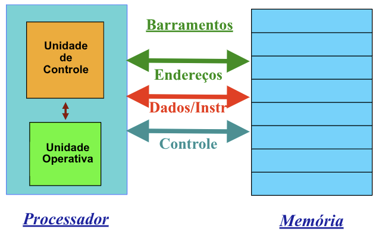

### Arquitetura Harvard

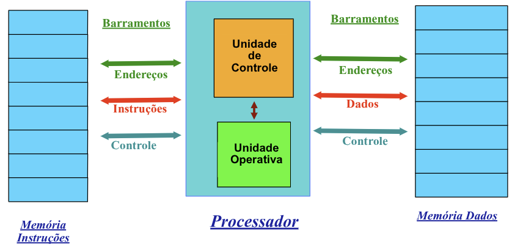

## Unidade Operativa 
Também chamada **Parte Operativa**, Caminho de Dados ou, em inglês, ***"Datapath"***.

É construída a partir dos seguintes componentes: 
- Elementos de armazenamento (registradores, flip-flops) 
- Operadores lógico-aritméticos 
- Recursos de interconexão (barramentos, mux)

Será projetada para implementar o seguinte subconjunto de instruções do RISC-V: 
- Instruções de referência a memória: `lw` e `sw` 
- Instruções lógicas e aritméticas: `add`, `sub`, `and`, `or` e `slt` 
- Instruções de fluxo de controle: `beq` e `jal`

### Sinopse da Implementação

Implementação Genérica: 
- Use o contador de programa (PC) para fornecer endereço da instrução. 
- Obtenha a instrução da memória 
- Leia os registradores 
- Use a instrução para decidir exatamente o que fazer 

> [!IMPORTANT]
>
> **Todas as instruções** usam a **ALU** após lerem os registradores.

### Implementação Básica

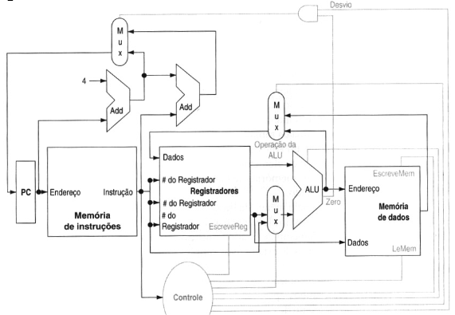

- **Unidade de Controle:** 1 único ciclo de clock. 
- Elementos **combinacionais** e **sequenciais**.
- **Observação:** 
    - Em vários pontos temos dados vindo de duas origens diferentes. 
    - As unidades precisam ser controladas.

### Componentes Combinacionais
Componentes combinacionais definem o valor de suas saídas apenas em função dos valores presentes nas suas entradas.

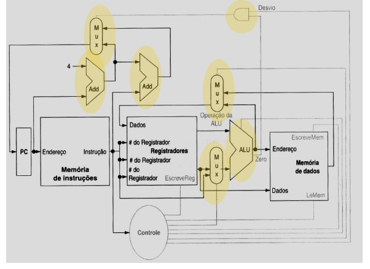

### Componentes Sequenciais
Componentes armazenadores de estado, as saídas dependem das entradas e do tempo.

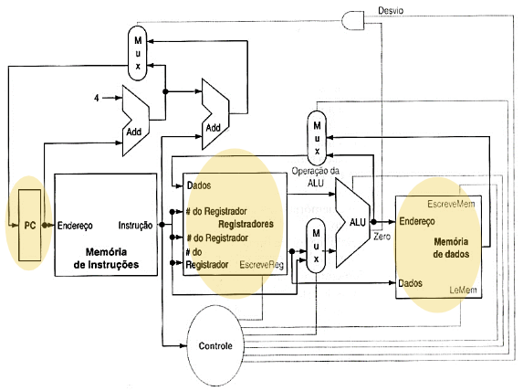

Componentes sequenciais têm um **estado**, que **define seu valor em um dado instante** de tempo.

**Registrador:** 
- Um conjunto de ***flip-flops*** tipo **D** (Registrador) 
    - Com `n bits` de entrada e saída. 
    - Entrada de habilitação de escrita. 
- Habilitação de escrita (***Write Enable - WE***): 
    - 0: O dado de saída **não muda**. 
    - 1: O dado de entrada será carregado (saída = entrada) na transição do clock.

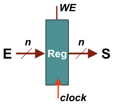

### Mémoria
Memória (One/Two/Three... Ports) 
- Um barramento de entrada: `Data In` 
- Um barramento de saída: `Data Out`

Uma palavra é selecionada por: 
- Um endereço seleciona a palavra para ser colocada na saída (**Data out**). 
- `Write Enable = 1`: Permite que a palavra selecionada seja **escrita com a informação na entrada** (`Data in`). 

Entrada de Clock (`CLK`): Sincroniza os processos de acesso à memória.

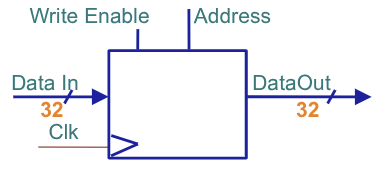

## Estratégia de Temporização
- Uma metodologia de temporização define quando **os sinais podem ser lidos** e quando eles podem **ser escritos**. 
- É necessário evitar **situações de conflito**, por exemplo, querer ler uma palavra e escrevê-la simultaneamente. 
- Será adotada uma metodologia de temporização sensível às transições do sinal do clock. 
- Nesta metodologia, qualquer valor armazenado nos **elementos de estado** só pode ser atualizado durante a **transição do sinal de relógio** (**clock**).

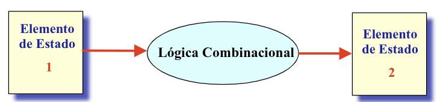

- Lógica combinacional usualmente tem **entradas e saídas conectadas** a elementos de estado (sequenciais) 
- O elemento de estado 2 só pode ser escrito depois de os dados em sua entrada estarem estáveis: 
    - Atraso de propagação no elemento de estado 1 
    - Atraso da lógica combinacional 
    - Tempo de pré-carga (setup time) no elemento de estado 2

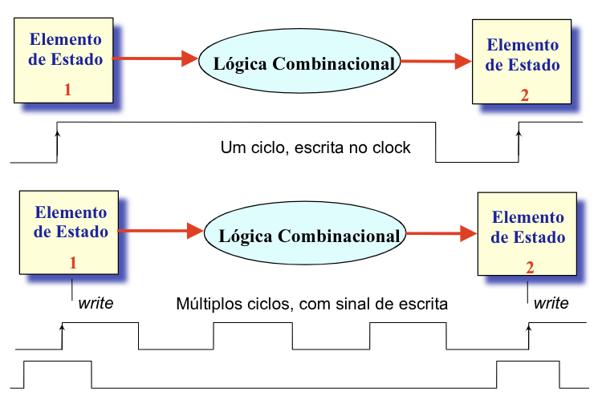

## Criando a Unidade Operativa
Uma maneira de se começar o projeto de uma unidade operativa (***data path***) é **examinar cada** um dos **componentes necessários** para a execução de cada uma 
das classes de instruções do RISC-V.

Elementos Necessários: 
- Um lugar para armazenar as instruções (**memória de instruções**) 
- Um registrador para armazenar o endereço de instrução (**Program Counter – PC**) 
- Um contador para incrementar o PC, para compor o endereço da próxima instrução (soma 4 para endereçar próxima instrução).

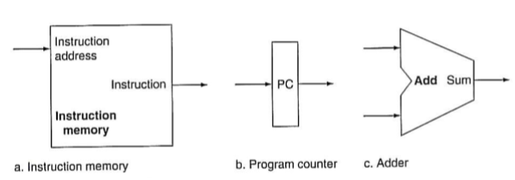

### Instruções Lógico-Aritméticas

Formato de uma instrução tipo R:

| Campo | funct7 | rs2 | rs1 | funct3 | rd | opcode |
|---|---|---|---|---|---|---|
| **Tamanho** | 7 bits | 5 bits | 5 bits | 3 bits | 5 bits | 7 bits |

- Semântica: $x[rd] \leftarrow op(x[rs1],x[rs2])$
- Estrutura de Suporte: **Banco de Registradores**

### Banco de Registradores
- **Dupla Porta:** Leitura de dois registradores ao mesmo tempo. 
- Sinal de controle para escrita: Leitura não necessita controle.

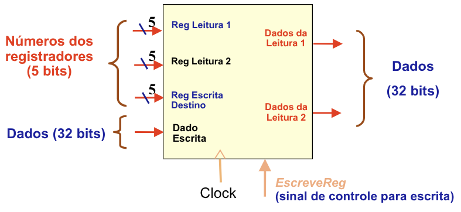

### Projeto da ULA
- A ULA é apresentada no anexo do livro. 
- 4 bits de controle indicam a operação a ser realizada.

| Linhas de controle da ALU | Função                 |
|:-------------------------:|------------------------|
| 0000                      | AND                    |
| 0001                      | OR                     |
| 0010                      | add                    |
| 0110                      | subtract               |
| 0111                      | set on less than       |
| 1100                      | NOR                    |

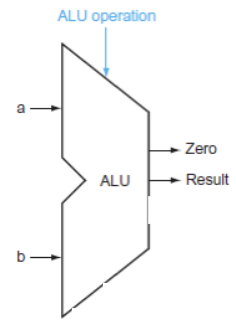


### Memória
- Memória com um barramento de entrada independente do de saída. 
- Controle de escrita (*write*) e leitura (*read*). 
- Barramento de endereços. 
- Um acesso de cada vez.

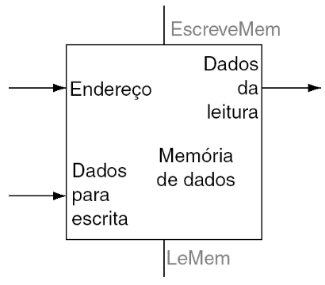

### Extensão de Sinal do Imediato

A forma de geração do imediato depende da instrução: 
- `lw`: Imediato = { 20x{Instr[31]}, Instr[31:20] }  
- `sw`: Imediato = { 20x{Instr[31]}, Instr[31:25], Instr[11:7] }  
- `beq`: Imediato = { 20x{Instr[31]}, Instr[7], Instr[30:25], Instr[11:8] } 
- `jal`: Imediato = { 12x{Instr[31]}, Instr[19:12], Instr[20], Instr[30:21] }

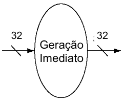

### Acesso a Memória

- `lw`: Lê um dado da memória e escreve em um registrador. 
    - Conexão entre a saída da memória e a entrada do banco de registradores. 
- `sw`: Lê um dado de um registrador e escreve na memória. 
    - Ligação entre saída do banco de registradores e entrada de dados da memória. 
- Endereço **calculado através da ULA** 
    - Saída da ULA ligada ao barramento de endereços da memória.

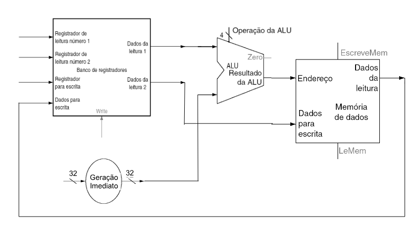

### Instruções de Desvio

`beq  t1, t2, desloc`
- Compara dois registradores 
- Soma **desloc palavras ao endereço** PC se `t1 = t2`. 
- No Assembly utiliza-se uma versão simplificada, com o rótulo do destino. 
    - `beq t1, t2, LABEL` 
    - Neste caso, o montador calcula o deslocamento a ser usado. 
- **desloc** é um deslocamento de **meias palavras**, ou seja, cada unidade de desloc corresponde a 2 bytes. 
- No RiscV, a **comparação** entre os registradores é **feita pela ULA**, sendo a resposta colocada na saída como um **valor Booleano**. 
- O PC deve ser carregado com `PC + 4` ou  `PC + desloc*2`, de acordo com o resultado do teste. 
- A multiplicação de **desloc por 2** é feita **deslocando-se 1 bit a esquerda** o seu valor. 
- Dependendo da implementação, o deslocamento pode ser  feito dentro do gerador de valores imediato.

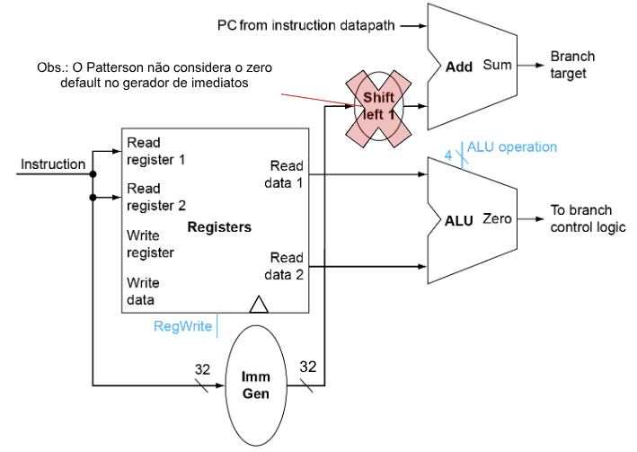

### Observações
- Para realizar a comparação dos dois operandos precisamos usar o banco de registradores. 
- O cálculo do endereço de desvio foi incluído no circuito. 
- Na instrução não é preciso **escrever no banco de registradores**. 
- A **comparação será feita pela ULA**, com o resultado disponibilizado através do bit **0 da saída da ULA**.

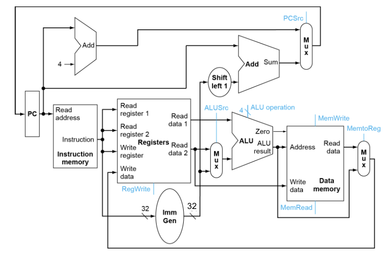

## Unidade de Controle 

- Foram desenvolvidas, na verdade, três tipos de unidades operativas: 
    - Uma para instruções no **formato R** (`add`, `sub`, etc.) 
    - Uma para instruções de **acesso a memória** `lw` e `sw` - **formato I e S** 
    - Uma para **instruções condicionais** (`beq`) – **formato SB** 
- Na fase de projeto às vezes precisamos replicar recursos. 
- Na via de dados mais simples deve-se propor **executar as instruções em um único período do clock**. 
- Isto quer dizer que **nenhum dos recursos pode ser usado mais de uma vez por instrução**.

**Exemplo:** Log-Aritméticas/Load/Store

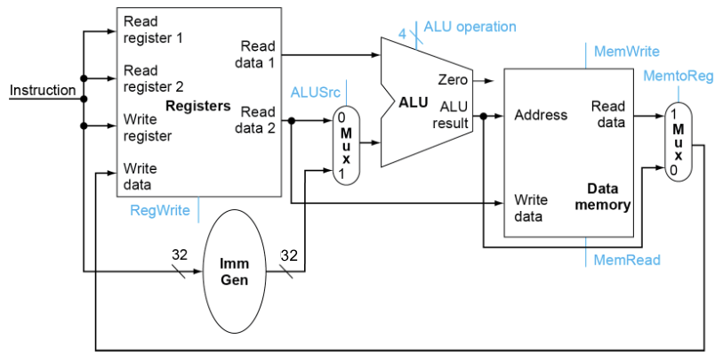

### Controle do RISC-V

Cada operação requer a utilização adequada dos recursos do RISC-V. 

Ex: `add t0, s1, s2` 
- É necessário que os **endereços dos operandos** `s1` e `s2` sejam **enviados ao banco de registradores**. 
- Da mesma maneira, o **endereço do registrador destino** (`t0`) deverá ser informado ao banco de registradores. 
- Uma vez que o banco de registradores **disponibilize os valores** de `s1` e `s2`, estes deverão ser encaminhados à **ULA**. 
- Posteriormente, o **resultado** deverá ser **escrito no banco de registradores** (registrador t0).

### Controle da ULA

As operações da ULA são controladas por um código de 4 bits:

| Linhas de Controle ULA | Função |
|:----------------------:|--------|
| 0000                   | AND    |
| 0001                   | OR     |
| 0010                   | ADD    |
| 0110                   | SUB    |
| 0111                   | SLT    |

- As instruções **load** e **store** utilizam a operação de **soma da ULA**. 
- As instruções do **tipo R** utilizam uma das 5 operações. 
- A instrução **beq** utiliza a **subtração da ULA**.

#### Identificação da Operação
- Os Opcodes definem as operações: 
    - lw(0x03), sw(0x23), beq(0x63), Tipo-R (0x33) 
- No Tipo-R os campos `funct7` e `funct3`, **especificam o tipo de operação** aritmética/lógica. 
- Vamos definir 2 bits para identificar cada uma das **categorias de instruções** (opALU): 
    - `00`: Acesso à memória (lw, sw) [add] 
    - `01`: Desvio (beq, bne, blt, bge, bltu, bgeu) [sub]
    - `10`: Lógico-aritméticas (add, sub, and, or, slt)

Circuito de Controle da ULA
- 'x' indica irrelevâncias (*don’t cares*)

| Opcode | ALUOp | Operação | Funct7  | Funct3 | Operação da ULA | ALU Control |
|--------|:-----:|----------|:-------:|:------:|:---------------:|:-----------:|
| lw     | 00    | Load     | xxxxxxx | xxx    | add             | 0010        |
| sw     | 00    | Store    | xxxxxxx | xxx    | add             | 0010        |
| beq    | 01    | Beq      | xxxxxxx | xxx    | sub             | 0110        |
| Tipo-R | 10    | Add      | 0000000 | 000    | add             | 0010        |
| Tipo-R | 10    | Sub      | 0100000 | 000    | sub             | 0110        |
| Tipo-R | 10    | And      | 0000000 | 111    | and             | 0000        |
| Tipo-R | 10    | Or       | 0000000 | 110    | or              | 0001        |
| Tipo-R | 10    | Slt      | 0000000 | 010    | slt             | 0111        |

Tabela Verdade Controle ULA
- Uma tabela simplificada com irrelevâncias. Pode-se derivar um circuito lógico que gera as 4 saídas.

| ALUOp p1 | ALUOp p0 | I[31] | I[30] | I[29] | I[28] | I[27] | I[26] | I[25] | I[14] | I[13] | I[12] | ALU Control (Operação) |
|:--------:|:--------:|:-----:|:-----:|:-----:|:-----:|:-----:|:-----:|:-----:|:-----:|:-----:|:-----:|:----------------------:|
| 0 | 0 | x | x | x | x | x | x | x | x | x | x | 0010 |
| 0 | 1 | x | x | x | x | x | x | x | x | x | x | 0110 |
| 1 | 0 | 0 | 0 | 0 | 0 | 0 | 0 | 0 | 0 | 0 | 0 | 0010 |
| 1 | 0 | 0 | 1 | 0 | 0 | 0 | 0 | 0 | 0 | 0 | 0 | 0110 |
| 1 | 0 | 0 | 0 | 0 | 0 | 0 | 0 | 0 | 1 | 1 | 1 | 0000 |
| 1 | 0 | 0 | 0 | 0 | 0 | 0 | 0 | 0 | 1 | 1 | 0 | 0001 |
| 1 | 0 | 0 | 0 | 0 | 0 | 0 | 0 | 0 | 0 | 1 | 0 | 0111 |


#### Exemplo VHDL: Controle da ULA
```vhdl
entity cntrULA is
    port 
    ( 
        funct7 : in std_logic_vector(6 downto 0);
        funct3  : in std_logic_vector(2 downto 0);
        aluop   : in std_logic_vector(1 downto 0);
        aluctr  : out std_logic_vector(3 downto 0)
    );
end entity;

architecture arch of contrULA is
begin
    process(funct7, funct3, aluop) begin
        case aluop is
            when "00" => aluctr <= "0010";  -- soma
            when "01" => aluctr <= "0110";  -- subtração
            when "10" => case funct3 is
                            when "000" => if (funct7(5) = '1')
                                                then aluctr <= "0110";
                                                else aluctr <= "0010";
                                            end if;
                            when "111" => aluctr <= "0000";
                            when "110" => aluctr <= "0001";
                            when "010" => aluctr <= "0111";
        end case;
    end process;
end architecture;
```

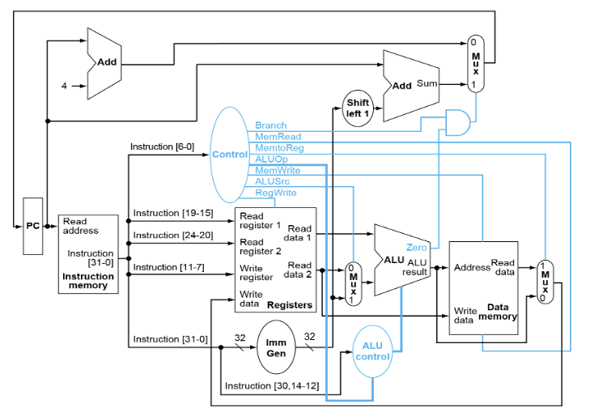

### Entrada da Unidade de Controle
**As informações necessárias a execução de uma instrução são retiradas da própria instrução** 
- O opcode (código de operação) sempre está nos bits `RI[6-0] = Op[6:0]`. 
- Os 2 registradores a serem lidos (rs1 e rs2) sempre estão nas posições `RI[19:15]` e `RI[24:20]` (tipo-R, beq e sw). 
- O registrador destino (rd) está sempre na posição `RI[11:7]`. 
- O dado Imediato depende da instrução.

### Sinais de Controle
A unidade de controle de prover: 
- Sinais para os multiplexadores. 
- Sinais de **leitura** e **escrita** para as memórias. 
- **Seleção da operação** da ULA. 
- Controle do **novo endereço a ser carregado no PC**, para instruções de salto.

| Instrução | Opcode  | ALUSrc | Mem2Reg | RegWrite | MemRead | MemWrite | Branch | ALUOp |
|-----------|:-------:|:------:|:-------:|:--------:|:-------:|:--------:|:------:|:-----:|
| Tipo-R    | 0110011 | 0      | 0       | 1        | 0       | 0        | 0      | 10    |
| lw        | 0000011 | 1      | 1       | 1        | 1       | 0        | 0      | 00    |
| sw        | 0100011 | 1      | X       | 0        | 0       | 1        | 0      | 00    |
| beq       | 1100011 | 0      | X       | 0        | 0       | 0        | 1      | 01    |

Implementações 
- Lógica Combinacional (síntese lógica) 
- ROM 
- PLAs (**soma de produtos**): 
    - Lógica AND decodifica a instrução 
    - Lógica OR identifica os acionamentos: 
        - Ex: RegWrite = (Tipo-R OR lw)

## Problemas com RISC-V Uniciclo
Período do relógio determinado pelo **caminho mais longo** 
- **Instrução** `lw`:
    - Leitura da instrução 
    - Leitura do registrador de base, extensão de sinal 
    - Cálculo do endereço 
    - Leitura do dado da memória  
    - Escrita em registrador 

- **TODAS** as instruções levam o mesmo tempo para executar: `CPI = 1` E ainda! 
    - Viola o princípio de tornar o caso comum rápido! 
    - Unidades funcionais duplicadas

### Análise de Desempenho Uniciclo
Supondo os seguintes tempos de execução das unidades operativas: 
- Acesso a memória: 200ps 
- ULA e somadores: 100ps 
- Acesso ao banco de registradores (leitura ou escrita): 50ps 
- Multiplexadores, Unidade de Controle, acesso ao PC, Unidade de Extensão de Sinal e fios considerados sem atraso (!!!!) 

Qual das seguintes implementações seria mais rápida e quanto? 
1. Implementação onde toda instrução é feita em 1 ciclo de clock de duração fixa. 
2. Implementação onde toda instrução é feita em 1 ciclo de clock de duração somente o necessário (!!exemplo ideal - didático!!) 

Para comparação consideremos um workload composto de: 25% loads, 10% stores, 45% ALU, 15% desvios condicionais, 5% jumps.

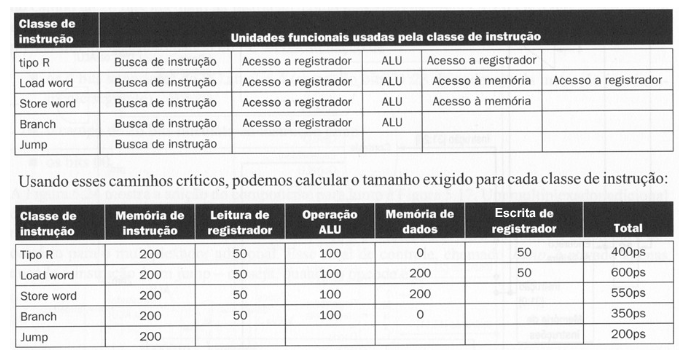

Tempo Médio:  
- Uniciclo Fixo: $600$ ps 
- Uniciclo Variável: $600 \times 0.25 + 550 \times 0.1 + 400 \times 0.45 + 350 \times 0.15 + 200 \times 0.05 = 447.5$ ps 
- Fator de Desempenho: $n = \frac{600}{444.5} = 1.34$
