# Multiciclo

- **Ideia:** Cada **fase de execução** de uma instrução dura **um ciclo de relógio**.
- Instruções podem ser executadas em um **número diferente** de ciclos. 
- Exemplo: 
    - `lw` demora 5 ciclos 
    - `jump` demora 3 ciclos 
    - `add` demora 4 ciclos

- Ciclo dimensionado de acordo com a **etapa** mais demorada. 
- Vamos **reutilizar unidades funcionais** 
    - `ULA` usada também para **calcular endereço** e **incrementar o PC**. 
    - `Memória` usada para **armazenar instrução** e **dados**. 
- A organização da parte operativa pode ser re-estruturada em função destas características. 
- **Sinais de controle** não serão determinados diretamente pela instrução, e sim pela `instrução + etapa`. 
- Usaremos uma **máquina de estados finita** para controle.

## Unidade Operativa

Dividir as instruções em **etapas**, cada uma **durando um ciclo** 
- Requilibrar a quantidade de trabalho a ser feito. 
- **Restringir cada ciclo** para usar **apenas uma vez cada unidade funcional**.

No final de um ciclo 
- Armazenar os valores para uso em ciclos posteriores.
    - Lembrar circuitos sequenciais.
- Logo, necessita introduzir registradores auxiliares "internos" adicionais.

Visão Abstrata: 
- Uma única `ULA` 
- Uma única `Unidade de Memória` 
- **Registradores Auxiliares** após unidades funcionais.  
    - Onde colocá-los? Unidade combinacional de 1 ciclo e onde necessitar ser salvo. 

Detalhamento: 
- Todos os registradores auxiliares precisam manter o dado por **1 ciclo apenas** (EXCEÇÃO IR) 
- Logo não necessitam de pino de controle de escrita 
- Incluir e expandir Multiplexadores para poder reusar Unidades Funcionais.

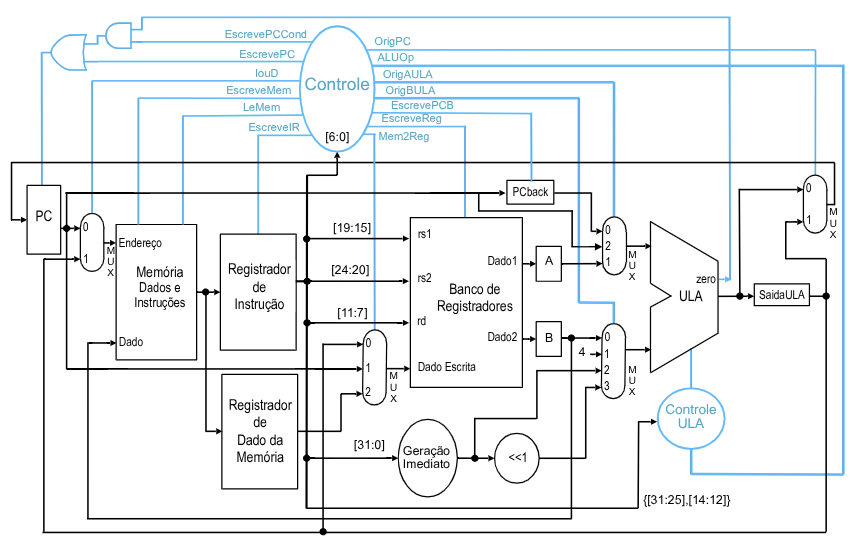

### Ações dos Sinais de Controle

| Sinal           | Valor | Efeito                                                                    |
|-----------------|:-----:|---------------------------------------------------------------------------|
| EscreveReg      |   0   | Não permite a escrita no Banco de Registradores                           |
|                 |   1   | O Registrador de Destino é escrito com o Dado de Escrita                  |
| OpALU           |  00   | Soma                                                                      |
|                 |  01   | Subtração                                                                 |
|                 |  10   | Os campos {Funct7,Funct3} definem a operação                               |
| OrigALUA        |   0   | Primeiro argumento da ULA é o registrador PC                              |
|                 |   1   | Primeiro argumento da ULA é o registrador A                               |
| OrigBULA        |  00   | Segundo argumento da ULA é o registrador B                                |
|                 |  01   | Segundo argumento da ULA é o número 4                                     |
|                 |  10   | Segundo argumento da ULA é o imediato                                      |
|                 |  11   | Segundo argumento da ULA é o imediato deslocado 1 bit                     |
| LeMem           |   0   | Desabilita a leitura da Memória                                            |
|                 |   1   | Habilita a leitura da Memória                                              |
| EscreveMem      |   0   | Desabilita a escrita na Memória                                            |
|                 |   1   | Habilita a escrita na Memória                                              |
| Mem2Reg         |  00   | O valor escrito no Banco de Registradores vem da SaídaALU                  |
|                 |  01   | O valor escrito no Banco de Registradores vem do PC                        |
|                 |  10   | O valor escrito no Banco de Registradores vem do MDR                       |
| IouD            |   0   | O PC é usado para endereçar a memória                                      |
|                 |   1   | O registrador SaídaALU é usado para endereçar a memória                    |
| EscreveIR       |   0   | Desabilita a escrita no IR                                                 |
|                 |   1   | Habilita a escrita no IR                                                   |
| EscrevePC       |   0   | Desabilita a escrita incondicional no PC                                   |
|                 |   1   | Habilita a escrita incondicional no PC                                     |
| EscrevePCCond   |   0   | Desabilita a escrita condicional no PC                                     |
|                 |   1   | Habilita a escrita condicional no PC                                       |
| EscrevePCB      |   0   | Desabilita a escrita do PCBack                                             |
|                 |   1   | Habilita a escrita no PCBack                                               |
| OrigPC          |   0   | O valor escrito no PC é o resultado da ULA                                 |
|                 |   1   | O valor escrito no PC é o registrador SaídaULA                             |

### Controle Multiciclo

**Exemplo:** Instrução Tipo-R, poderia ser pensada na seguinte instrução em linguagem de descrição de hardware (HDL): 

`Reg[Memory[PC][15:11]] <=  Reg[Memory[PC][25:21]] op Reg[Memory[PC][20:16]];`

Decomposta nas seguintes etapas usando "variáveis locais":
1. `R <= Memory[PC];`: Busca instrução 
2. `A <= X[IR[25:21]];` e `B <= X[IR[20:16]];`: Busca operandos  
3. `saidaALU <= A op B;`: Execução da operação 
4. `X[IR[15:11]] = saidaALU;`: Escreve o resultado 
5. `PC <= PC+4;`: Calcula endereço próxima instrução

### Controle Multiciclo: 5 Etapas
Considerando:  
- 1 acesso à memória, 1 acesso ao banco de registradores ou 1 operação da ULA **por 
ciclo**. (determina o ciclo de clock) 
- Projeto acionado por **transição** (valores dos regs não muda até então) 

#### 1. Etapa de Busca da Instrução 

```
IR <= Memoria[PC]; 
PCback <= PC; 
PC <= PC + 4;
```

Execução: Ler a Instrução da memória e incrementar PC 
- Ativar os sinais de controle `LeMem` e `Escreve IR` 
- Definir PC como origem do endereço: Colocar IouD em 0 
- Incrementar PC+4: 
    - `OrigAALU`: 0 (PC para ALU), 
    - `OrigBALU`: 01 (4 para ALU) 
    - `opALU`: 00 (Soma). 
- Armazenar o endereço de instrução incrementado em PC: 
    `origPC` 00 e ativar `EscrevePC`. 
- Armazenar PC atual em `PCback`: Ativar EscrevePCB.

#### 2. Etapa de Decodificação da Instrução e Busca de operandos

```
A <= X[IR[25:21]]; 
B <= X[IR[20:16]]; 
SaidaALU <= PCback + (imediato << 1);
```

Execução: Como não sabemos qual a instrução ainda, podemos fazer ações gerais que não causem problemas depois! 
- Acessar o banco de registradores e ler `rs1` e `rs2` e armazenar em `A` e `B`. 
- **Cálculo prévio** do **endereço de desvio** e coloca em `SaidaALU`: 
    - `OrigAALU` em 0 ( PCback para ALU), 
    - `OrigBALU` em 11 (imediato << 1 para ALU) e `opALU` 00 (soma).

#### 3. Etapa de Execução, Cálculo do Endereço de memória ou Conclusão de desvio

**Referência à Memória (lw,sw):**

```
SaidaULA = A + imediato
```

Execução: Calcular o endereço 
- `OrigAALU` em 1 (reg A), 
- `OrigBALU` em 10 (imediato), 
- `opALU` 00 (soma)

**Instrução Tipo-R:**

```
SaidaULA <= A op B
```

Execução: Os valores de A e B estão prontos!  
- `OrigAALU` em 1 (A na ALU), 
- `OrigBALU` em 00 (B na ALU), 
- `opALU` 10 (lógico-aritmética pelo campo funct7 e funct3)

**beq:**

```
if (A==B) PC <= SaidaALU
```

Execução: O endereço de desvio já está pronto.  
- `OrigAALU` em 1 (A na ALU), `OrigBALU` em 00 (B na ALU), `opALU` 01 (subtrai) 
- Ativar sinal `EscrevePCCond` 
- Colocar `OrigPC` em 01 (valor do PC vem da ULA) 

**Jal:**

```
PC <= SaidaULA; X[rd] <= PC+4 (já no PC)
```

Execução: PC é substituído pelo endereço de salto, salva endereço de retorno PC+4 
- Colocar `OriPC` em 1 (saída da ULA) 
- Ativar EscrevePC e EscreveReg 
- `Mem2Reg` em 01 (PC)

```
PC <= SaidaULA; X[rd] <= PC+4
```

#### 4. Etapa de acesso à memória ou Conclusão de instrucão Tipo-R

**Referência à memória (lw, sw):**

```
MDR <= Memoria[SaidaALU]; #para load 
ou 
Memória[saidaALU] <= B   # para store
```

Execução: Em qualquer dos casos o endereço já está na SaidaALU 
- `IouD` colocado em 1 (Endereço da ALU). 
- `LeMem` ou `EscreveMem` deve ser ativado.

**Instrução Tipo-R:**

```
X[IR[15:11]] <= SaidaALU
```

Execução: Colocar o resultado no reg destino 
- Ativar `EscreveReg` 
- Colocar `Mem2Reg` em 0 (saída da ALU na entrada do banco de reg)

#### 5. Conclusão da Leitura da Memória (lw)

```
X[rd] <= MDR;
```

Execução: Escrever o dado do MDR no banco de reg 
- Colocar `MemparaReg` em 1 (resultado da memória) 
- Ativar o `EscreveReg`

### Resumo do Controle do Multiciclo

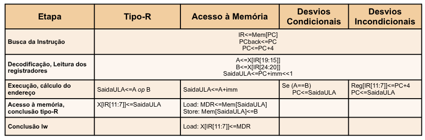

Exemplo: Considerando um workload de 25% loads, 10% stores, 11% branches, 
2% jumps e 52% operações com ALU. Qual a CPI média implementada?

Maneira Tradicional: $ 0.25 \times 5 + 0.1 \times4 + 0.52 \times 4 + 0.11 \times 3 + 0.02 \times 3 = 4.12$.

Maneira Rápida: Fazer a diferença percentual das CPI de loads (5) e jump e branch (3).
- $ 25\% - (11 + 2)\% = 12\%$, logo CPI = $4.12$.

## Unidade de Controle

- Controle feito em uma série de etapas 
- Técnicas de Implementação:
    - Máquinas de Estados Finita 
    - Microprogramação    

| Representação | Diagrama de estados finitos | Microprograma |
|---|---|---|
| Controle de Sequenciação | Função de próximo estado explícita | Contador de programa + ROM |
| Representação Lógica | Equações Lógicas | Tabelas Verdade |
| Técnica de Implementação | PLA | ROM |

### Máquina de Estados Finita - MEF
- **Diagrama de Estados**. 
- Cada nó do diagrama representa um estado. 
- A transição entre estados é indicada por arcos. 
- As condições de disparo de uma transição são associadas aos arcos. 
- Cada **estado** corresponde a **um ciclo de relógio**.

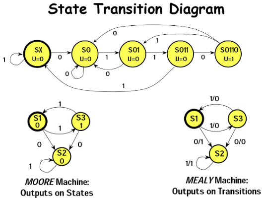

### MEF do Controle do MIPS Multiciclo
Análise do controle para toda a ISA implementada: 

1. Busca da Instrução 
2. Decodificação 
3. Execução 
4. Acesso à Memória e Conclusão Tipo-R 
5. Conclusão LW

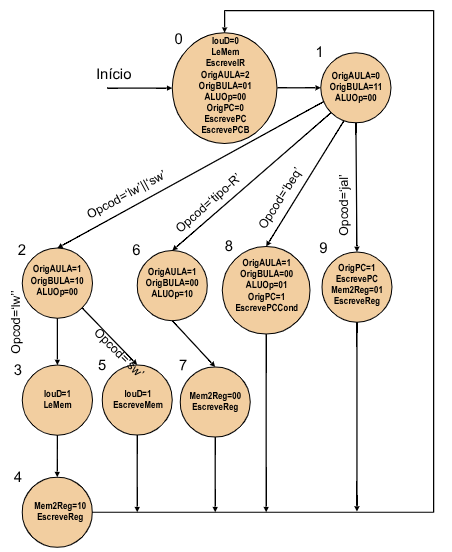

Máquinas de Estados Finita - Implementação
- Conjunto de estados. 
- **Função de próximo estado:** Determinada pelo estado atual e entrada. 
- **Saída:** Determinada pelo estado atual (**Moore**) e possivelmente pela entrada (**Mealy**).

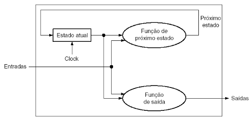

## Controle com MEF

Estrutura da máquina de estados: 
- Lógica de saída 
- Lógica de transição 
- Registrador de estado 
- Entradas externas (código da instrução)

### Implementação com ROM
Tamanho da memória 
- 11 bits endereço: 2048 posições de memória. 
- 20 bits de dados
    - ROM de 40kbits
- Porém é ineficiente, pois utilizameros apenas 9 posições de memória já que temos 9 estados distintos. 

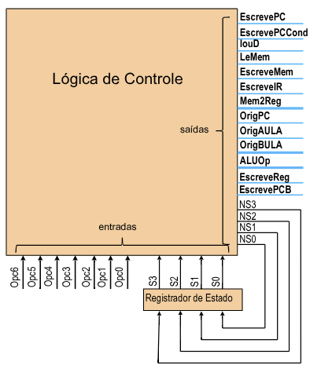

Exemplo: Projeto lógico para cada saída na forma soma de produtos

- EscrevePC: Acionado nos estados 0 ou 9

| S3 | S2 | S1 | S0 |
| :-:| :-: | :-: | :-:|
| 0 | 0 | 0 | 0 |
| 0 | 0 | 1 | 0 |
| 0 | 1 | 1 | 0 |

$\text{EscrevePC} = \bar{s_3} \cdot \bar{s_2} \cdot \bar{s_1} \cdot \bar{s_0} + s_3 \cdot \bar{s_2} \cdot \bar{s_1} \cdot s_0$

- $NS_0$: Acionado nos estados 0, 2, 6 ou 1 (caso `opcode = jal`)

| Op6 | Op5 | Op4 | Op3 | Op2 | Op1 | Op0 | S3 | S2 | S1 | S0 |
|---|---|---|---|---|---|---|---|---|---|---|
| x | x | x | x | x | x | x | 0 | 0 | 0 | 0 |
| x | x | x | x | x | x | x | 0 | 0 | 1 | 0 |
| x | x | x | x | x | x | x | 0 | 1 | 1 | 0 |
| 1 | 1 | 0 | 1 | 1 | 1 | 1 | 0 | 0 | 0 | 1 |

$NS_0 = \bar{s_3} \cdot \bar{s_2} \cdot \bar{s_1} \cdot \bar{s_0} + \bar{s_3} \cdot \bar{s_2} \cdot s_1 \cdot \bar{s_0} + \bar{s_3} \cdot s_2 \cdot s_1 \cdot \bar{s_0} + Op_6 \cdot Op_5 \cdot \bar{Op_4} \cdot Op_3 \cdot Op_2 \cdot Op_1 \cdot Op_0 \cdot \bar{s_3} \cdot \bar{s_2} \cdot \bar{s_1} \cdot s_0$

### Implementação com PLA 
- Programmable Logic Array

- Mais eficiente: 
    - Pode compartilhar termos de produtos. 
    - Apenas entradas que possuem saídas ativas. 
    - Pode considerar don't cares.

Tamanho = (Entradas $\times$ N.Prod.) + (Saidas $\times$ N.Prod) 

Tamanho: $(11 \times 17) + (20 \times 17) = 527$ células 

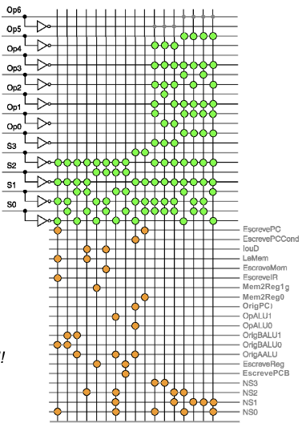

## Microprogramação
Problemas da MEF: 
- O projeto da parte de controle através de diagramas de transição de estados pode rapidamente se tornar inviável se o **número de estados for muito grande**. 
- MEF's de **processadores complexos** (x86, x64) podem ter milhares de estados. 

Uma alternativa para projeto é seguir um processo semelhante a programação.

- Uma **microinstrução** é definida pelos **valores dos sinais de controle** que atuam na unidade operativa durante um estado da MEF (`ESTADO`). 
- A execução de uma instrução do processador pode então ser realizada através de uma **sequência de microinstruções** (`TRANSIÇÕES`). 
- O **conjunto de microinstruções** que implementa o controle de um processador é chamado de **microprograma** (`DIAGRAMA DE ESTADOS`).

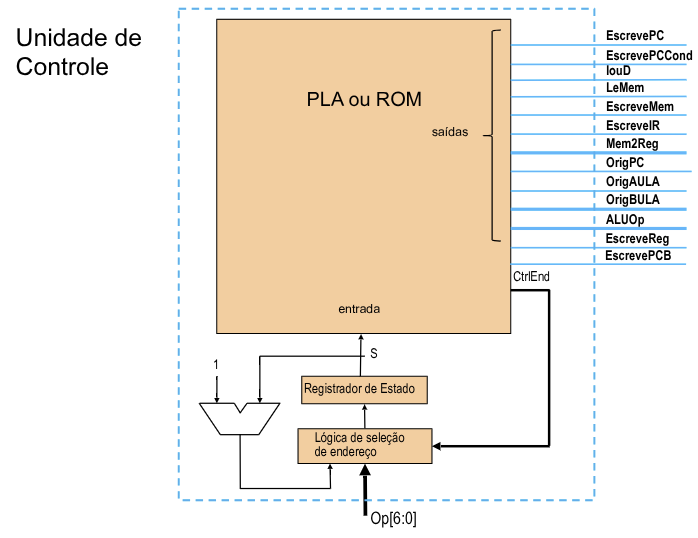

### Microprograma
O sequenciamento das microinstruções é realizado de forma similar a de um programa norma.
- Microinstruções são usualmente **executadas em sequência**. 
    - Correspondem aos caminhos no diagrama de estados. 
- Em alguns casos, a sequência a ser seguida depende de informações externas (código da instrução, por exemplo). 
- Nestes casos, são necessários mecanismos de desvio.

Sequenciamento para o subset do RISC-V
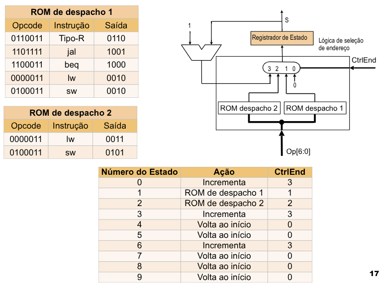

### Formato da Microinstrução
- A **microinstrução** é dividida em **campos** que atuam sobre conjuntos de elementos da **unidade operativa**. 
- Os campos são escolhidos de acordo com sua finalidade. O controle da ULA, por exemplo, é associado a um campo. 
- O microprograma é usualmente implementado em **ROM ou PLA**, onde cada microinstrução tem seu próprio endereço.

Função dos campos das Microinstruções
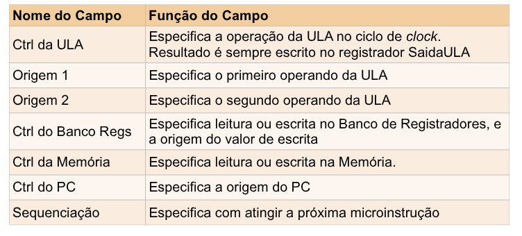

MicroISA
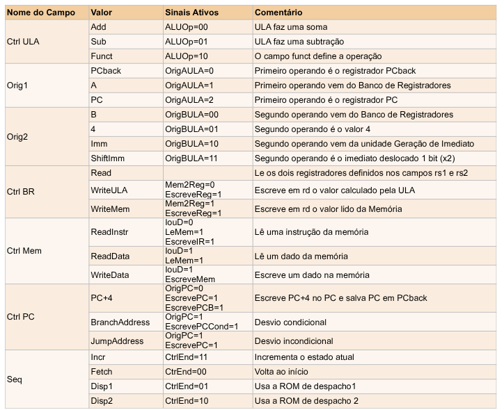

Microprograma para a Unidade de Controle RISC-V
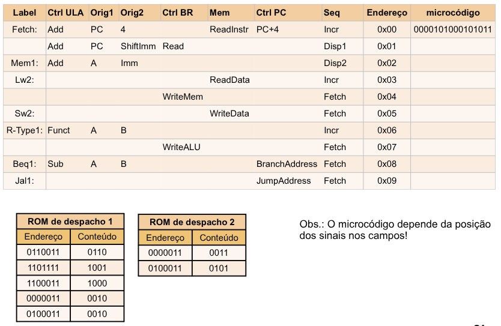

## Exercício
Considerando o workload do compilador `gcc`, qual a CPI média do RISC-V multiciclo implementado ?

- Load: 22% (5 ciclos) 
- Store: 11% (4 ciclos) 
- Operações aritméticas: 49% (4 ciclos) 
- Branches: 16% (3 ciclos) 
- Jumps: 2% (3 ciclos)

$22\% - 18\% = 4\%$, logo CPI = $4,04$
